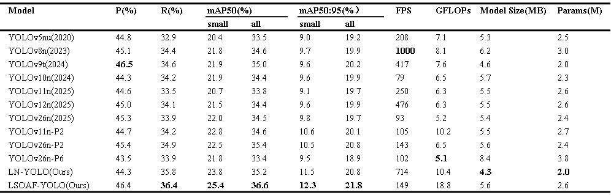

# LSOAF-YOLO: A Lightweight Small Object Detector with Attention Fusion for Aerial Remote Sensing Imagery

## <div align="center">Documentation</div>

### Benchmark

<div align=center>

</div>


Table Notes

* The model was initialized with pre-trained weights from the corresponding version.
* The input image resolution is 640×640.
* The training batch size is 4, with a total of 100 training epochs.
* All other parameters follow the settings of the baseline model.

### Quick Start

<details open>
<summary>Install</summary>

Clone the repository and install dependencies in a [**Python==3.9**](https://www.python.org/) environment, 
including [**PyTorch==2.1.0**](https://pytorch.org/get-started/previous-versions/) with [**CUDA==11.8**](https://pytorch.org/get-started/previous-versions/).

```bash
git clone https://github.com/sgg-ncee-lyx/LSOAF-YOLO.git  # Clone the LSOAF repository
cd LSOAF-YOLO  # Navigate to the cloned directory
pip install -e .  # Install the package in editable mode for development
```
</details>

<details open>
<summary>Training</summary>
The commands below reproduce LSOAF training results.

```bash
python train.py
```

</details>

<details open>
<summary>Evaluation</summary>
The commands below reproduce LSOAF evaluation results.

```bash
python val.py
```

</details>

### Implementation details

> **Note:** The core model definitions are not yet included in this repository. They will be released after the associated paper is published.

* Overall architecture: `ultralytics/cfg/models/LSOAF-YOLO.yaml` and `ultralytics/cfg/models/LN-YOLO.yaml` — to be released
* DAFM module: `ultralytics/nn/modules/DAFM.py` — to be released
* VolSA module: `ultralytics/nn/modules/Volumetric-SelfAttention.py` — to be released


### Data download

Note that all data must be cleaned and converted to YOLO format labels.

* VisDrone: [VisDrone](https://github.com/VisDrone/VisDrone-Dataset)
* TinyPerson: [TinyPerson](https://github.com/ucas-vg/PointTinyBenchmark/tree/master/dataset)
* UCAS-AOD: [UCAS-AOD](https://github.com/bingoxumo/UCAS-AOD_FFDP)

## Acknowledgement

The code implementation is based on [YOLOv11n](https://github.com/ultralytics/ultralytics), thanks to their open-source code.
The data is based on the [VisDrone](https://github.com/VisDrone/VisDrone-Dataset), [TinyPerson](https://github.com/ucas-vg/PointTinyBenchmark/tree/master/dataset), and [UCAS-AOD](https://github.com/bingoxumo/UCAS-AOD_FFDP) datasets, thanks to their open-source data.

## License

This project is licensed under the [AGPL-3.0 License](LICENSE), following the license of [Ultralytics YOLO](https://github.com/ultralytics/ultralytics), on which this work is based.

